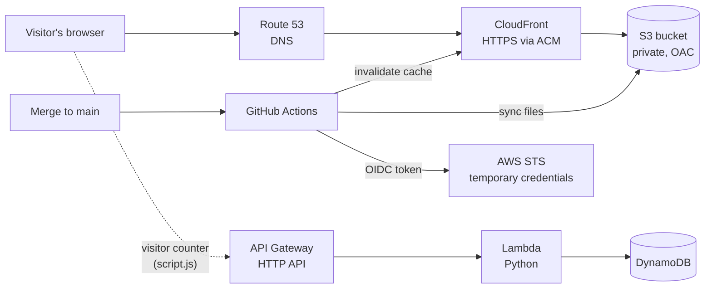

# Cloud Resume Website

My personal portfolio and resume site, built and hosted entirely on AWS, with a serverless visitor counter and an automated CI/CD pipeline.

**Live site:** [emmanuelataba.com](https://emmanuelataba.com)

This project started as my take on the [Cloud Resume Challenge](https://cloudresumechallenge.dev/) and grew into my main hands-on project for learning cloud infrastructure, API security, and production development workflows.

---

## Architecture



## Tech Stack

| Area | Tools |
|---|---|
| Frontend | HTML, CSS, JavaScript |
| Hosting | Amazon S3, CloudFront, Route 53, AWS Certificate Manager (ACM) |
| Backend | API Gateway (HTTP API), AWS Lambda (Python, Boto3), DynamoDB |
| Security | IAM (least privilege), Origin Access Control, CORS, API throttling |
| CI/CD | GitHub Actions, OpenID Connect (OIDC) |
| Tooling | Git, GitHub, Postman, CloudWatch, Google Search Console |

## How It Works

### Hosting
- The site's files live in a **private S3 bucket**. Only CloudFront can read it, through **Origin Access Control**.
- **CloudFront** serves the site over HTTPS using an **ACM certificate** that covers both the root domain and `www`.
- **Route 53** alias records (IPv4 and IPv6) point both domains to the CloudFront distribution.

### Visitor Counter
- On each page load, `script.js` sends a POST request to an **API Gateway HTTP API**.
- API Gateway invokes a **Python Lambda function**, which increments the count in **DynamoDB** using an **atomic update**, so simultaneous visits are never lost to a race condition.
- The new count is returned and displayed on the page.

### CI/CD Pipeline
- Every merge to `main` that changes the `frontend/` folder triggers a **GitHub Actions** workflow.
- The workflow authenticates to AWS with **OIDC**: GitHub issues a signed token, and AWS exchanges it for **temporary credentials** that expire automatically. No AWS access keys are stored anywhere.
- It syncs the site files to S3 (removing deleted files) and invalidates the CloudFront cache, so changes go live within minutes.

## Security

- **Private S3 bucket** with Origin Access Control: the files are not publicly accessible except through CloudFront.
- **Input validation** in the Lambda function: only the expected request shape and counter ID are accepted.
- **Generic error responses:** internal errors are logged privately to CloudWatch and never returned to callers.
- **Rate limiting** on the API (stage-level throttling) to protect cost and availability.
- **Restricted CORS:** only the site's own domains can call the API from a browser.
- **Least-privilege IAM:**
  - The Lambda role can only update one item in one DynamoDB table.
  - The deploy role can only write to the site's bucket and invalidate its distribution, and it trusts only this repository's `main` branch, matched by account and repository IDs.
- **Reduced attack surface:** unused API routes removed.

## SEO Site Ranking
- As an additional feature, the site was added to google's search console for SEO ranking on the internet.
- Created sitemap.xml and robots.txt file to help with this.
- Added the Validation 'TXT' record in Route 53 DNS to serve as proof of ownership of the domain.
- Then inspected the URL, requested indexing and just wait for Google to send reports after some time passed.

## Repository Structure

```
.
├── .github/workflows/
│   └── deploy.yml          # CI/CD pipeline
├── backend/
│   └── lambda_function.py  # Visitor counter Lambda
├── frontend/
│   ├── index.html
│   ├── style.css
│   ├── script.js
│   ├── images/
│   ├── robots.txt
│   └── sitemap.xml
└── README.md
```

## Development Workflow

1. Create a branch for each change (`feature/...` or `fix/...`).
2. Commit, push, and open a pull request.
3. Review the changes and merge into `main`.
4. GitHub Actions deploys the site automatically.

## Challenges and Lessons Learned

A few of the problems I worked through on this project:

- **OIDC role assumption failing:** GitHub's token subject now includes account and repository IDs. I found the mismatch by decoding the token's claims in a temporary debug step, then updated the IAM trust policy.
- **Security hardening:** testing the API revealed an unused route that crashed the Lambda and leaked internal error details. I removed the route and rewrote the function with validation and generic errors.
- **Race conditions:** the counter uses DynamoDB's atomic update instead of read, add, then write, so concurrent visits are counted correctly.
- **Deployment debugging:** diagnosing stale content layer by layer (browser cache, CloudFront, S3, local files) instead of guessing.

## Roadmap

- [ ] Rebuild the visitor counter backend in **Java with Spring Boot**
- [ ] Count unique visitors instead of page loads
- [ ] Contact form backend (API Gateway + Lambda + Amazon SES)
- [ ] Automated tests for the backend in the pipeline
- [ ] Site redesign

## Author

**Emmanuel Ataba**
[Website](https://emmanuelataba.com) · [LinkedIn](https://www.linkedin.com/in/emmanuelataba/) · [GitHub](https://github.com/zele9)
